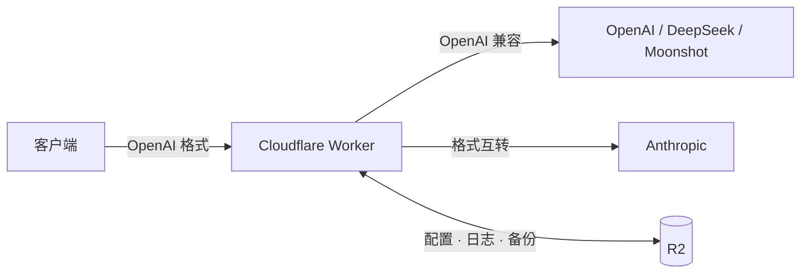

<div align="center">

<h1>OneAPI Gateway</h1>

<b>OpenAI 兼容的 AI 网关</b><br>
多渠道路由 · 故障转移 · 密钥与套餐 · 账号体系 · 中文控制台

<p>
  
  
  
  
</p>

<p><a href="#特性">特性</a> · <a href="#架构">架构</a> · <a href="#部署">部署</a> · <a href="#测试">测试</a> · <a href="#接口">接口</a> · <a href="#设置">设置</a> · <a href="#常见问题">常见问题</a></p>

</div>

> [!TIP]
> **一键部署**：Cloudflare 控制台连接 GitHub，构建时自动创建 R2 桶并绑定，无需手动建桶。

## 特性

| 模块 | 能力 |
| :--- | :--- |
| 接口 | `/v1/models`、`/v1/chat/completions`（流式）、`/v1/completions`、`/v1/embeddings` |
| 渠道 | OpenAI 兼容直通；Anthropic 原生自动互转（文本 / 图片 / tools / SSE） |
| 路由 | 优先级 + 权重、多 Key 轮询、失败换 Key、超时重试、熔断、长任务分流 |
| 模型 | `model_map` 映射、响应模型名回显、模型白名单、`*` 匹配 |
| 流式 | 双超时、下游保活、补发 `[DONE]`、Anthropic ping 转发、异常结束原因入库 |
| 密钥 | 多 Key 发放、配额 / 有效期 / 模型白名单 / RPM、用量统计、cURL 示例 |
| 账号 | 管理员初始化、用户名或邮箱登录、注册开关、问答找回、角色隔离、PBKDF2 |
| 套餐 | 定价与上下架、用户申请、审核生效、配额 / 有效期 / RPM / 模型限制 |
| 控制台 | 概览、渠道、密钥、日志、账号、套餐、网关设置、系统设置、明暗主题 |
| 运维 | 请求触发的内置保活、日志清理、每日备份、Telegram 告警（无需 Cron） |

### 流式健壮性

- **双超时**：`stream_first_byte_ms` 管首 token 前的等待，`stream_idle_timeout_ms` 管流中途静默。
- **下游保活**：超过 `stream_keepalive_ms` 未向下游发送字节时补 `: ka` SSE 注释，避免被 nginx / CDN 读超时掐断。
- **可靠收尾**：上游中断时补 error 事件与 `data: [DONE]`；上游漏发结束标记时由网关补发。
- **可观测**：日志记录 `finish`（`complete` / `client_abort` / `upstream_error` / `timeout`），可按「仅异常结束」筛选。

### 账号与权限

- 首次打开 `/admin` 初始化管理员；之后用用户名或邮箱 + 密码登录，`ADMIN_KEY` 仅作应急。
- 注册默认关闭；问答找回默认开启，答案忽略大小写与空格。
- 管理员管理全部资源；普通用户只能管理自己名下的密钥（最多 20 个）与套餐申请。
- 密码与安全答案用 PBKDF2-SHA256 + 随机盐存储，会话仅存 token 哈希；登录失败统一提示「账号或密码错误」。

### 套餐

- 套餐 = 价格 + Token 配额 + 有效期 + 账号级 RPM + 模型白名单。
- 用户提交申请，管理员审核通过后生效，并清零该账号名下密钥用量。
- 按申请时的条款快照执行；同套餐续费顺延，换套餐重新起算。
- 到期返回 `403 plan_expired`；模型白名单与密钥白名单取交集；任一 RPM 超限返回 `429`。

## 架构



1. **鉴权与限额** — 校验网关密钥、配额、有效期、模型白名单与 RPM。
2. **选择渠道** — 按模型匹配渠道，优先级 + 权重排序，多 Key 轮询。
3. **转发与收尾** — 流式转发、双超时、下游保活、失败重试与熔断。
4. **写入 R2** — 请求日志、按天统计、渠道与密钥状态、每日备份。

## 部署

### 1. 推送代码

```bash
git init && git add -A && git commit -m "init"
git remote add origin git@github.com:<你>/<仓库>.git
git push -u origin main
```

### 2. 连接 Cloudflare

**Workers & Pages → Create → Connect to Git**，选择仓库并填写：

| 项 | 值 |
| :--- | :--- |
| 构建命令 | `npm run build` |
| `CLOUDFLARE_ACCOUNT_ID` | Cloudflare 账户 ID |
| `CLOUDFLARE_API_TOKEN` | API Token，权限至少 **Account / R2 / Edit** |

点 **Save and Deploy**；构建日志出现 `[ensure-r2] ... 创建成功`（或「已存在」）即部署成功。

<details>
<summary><b>R2 为什么能自动创建？</b></summary>

`npm run build` 执行 `scripts/ensure-r2.mjs`：解析 `wrangler.toml` 的 `[[r2_buckets]]`，逐个检查桶是否存在，不存在则调用 Cloudflare API 创建，最后由 wrangler 部署并绑定。幂等，可重复执行。
</details>

> [!IMPORTANT]
> **无需 Cron Triggers**：保活、日志清理、备份都由「请求触发 + `ctx.waitUntil`」完成，间隔在「系统设置 → 限流 · 通知 · 备份」调整。零流量时不会运行，恢复流量后的首个请求会补跑。

### 3. 初始化

1. 打开 `https://<worker>.workers.dev/admin`，初始化管理员（用户名 / 邮箱、密码、安全问题）。
2. **渠道管理 → 添加渠道**：OpenAI 兼容填 Base URL + Key；Anthropic 原生填 `https://api.anthropic.com` + Key。Base URL 末尾不要带 `/v1`。
3. 多 Key 用英文逗号分隔（`sk-a,sk-b`），随机轮询，失败自动切换。
4. **密钥管理**生成网关密钥，分发给调用方。

```bash
curl https://<worker>.workers.dev/v1/chat/completions \
  -H "Authorization: Bearer <网关密钥>" \
  -H "Content-Type: application/json" \
  -d '{"model":"gpt-4o-mini","messages":[{"role":"user","content":"你好"}]}'
```

> [!NOTE]
> 建议在 **Settings → Variables and Secrets** 添加 `ADMIN_KEY`，忘记管理员密码时可用 `X-Admin-Key` 应急登录；日常登录不需要它。

## 本地开发

```bash
npm install
npx wrangler r2 bucket create oneapi-gateway-data
npx wrangler dev          # http://localhost:8787/admin
npm run deploy            # 手动部署：ensure-r2 + wrangler deploy
```

`.dev.vars` 可选写入 `ADMIN_KEY=xxx`。

## 测试

| 命令 | 覆盖 |
| :--- | :--- |
| `npm test` | 全量回归：账号 + 套餐 + 流式 + 内置保活 |
| `npm run test:accounts` | 初始化 / 登录 / 注册 / 找回 / 配额 / 备份恢复 |
| `npm run test:plans` | 套餐 CRUD / 申请审核 / 配额·有效期·RPM·模型限制 |
| `npm run test:stream` | SSE 分片、断流、超时、`[DONE]`、Anthropic 翻译与保活 |
| `npm run test:background` | 请求触发保活、清理、告警、备份与双层节流 |
| `npm run preview` | 生成 `preview/admin-preview.html` 静态预览 |

测试使用内存 R2 与模拟上游，不依赖外部服务。改动流式代码后务必跑 `npm run test:stream`。

## 接口

| 范围 | 接口 |
| :--- | :--- |
| 网关 | `GET /v1/models` · `POST /v1/chat/completions` · `POST /v1/completions` · `POST /v1/embeddings` |
| 公开 | `GET /` · `GET /healthz` · `GET /admin` · `GET /api/auth/state` |
| 账号 | `POST /api/auth/{setup,login,logout,register,recover,change-password,security}` · `GET /api/auth/recovery?username=` · `GET /api/auth/me` |
| 用户 | `GET/POST /api/user/keys`（create / rename / toggle / delete） · `GET/POST /api/user/plans`（request / cancel） |
| 管理 | `GET/POST /api/admin/{channels,keys,accounts,plans,settings}` · `GET /api/admin/ping` · `GET /api/admin/stats?days=N` |
| 日志 | `GET /api/admin/logs/dates` · `GET /api/admin/logs/summary?date=&limit=&cursor=&ok=&stream=&finish=&model=&q=` · `GET /api/admin/log?key=` · `POST /api/admin/logs/cleanup` · `POST /api/admin/logs/clear` |
| 运维 | `POST /api/admin/test-channel` · `POST /api/admin/test-all` · `POST /api/admin/test-route` · `GET /api/admin/backup` · `GET /api/admin/backups` · `POST /api/admin/restore` |

> 管理接口的 `accounts` / `plans` 通过 POST body 的 `action` 区分操作（create / update / delete / approve-request 等）。登录态使用 `X-Session-Token`（7 天），管理接口也接受应急 `X-Admin-Key`；`/api/*` 仅同源可用。

## 设置

### 网关设置

| 设置 | 默认 | 说明 |
| :--- | :---: | :--- |
| `allow_admin_key_as_api_key` | `true` | 是否允许 `ADMIN_KEY` 直接调用 `/v1/*`，生产建议关闭 |
| `request_timeout_ms` | `180000` | 上游请求超时（首字节） |
| `stream_idle_timeout_ms` | `180000` | 流式静默超时：上游超过该时长无任何字节即判定断流 |
| `stream_keepalive_ms` | `15000` | 下游保活间隔，0 = 关闭 |
| `retries` | `1` | 瞬时错误（429 / 5xx / 网络异常）的额外重试次数 |

### 系统设置

| 设置 | 默认 | 说明 |
| :--- | :---: | :--- |
| `allow_registration` | `false` | 开放自助注册；关闭时由管理员建号 |
| `allow_password_recovery` | `true` | 允许问答找回密码 |
| `default_user_quota_tokens` | `0` | 新用户默认 Token 配额，0 = 不限 |
| `log_retention_days` | `30` | 日志保留天数 |
| `timezone_offset_minutes` | `480` | 统计与日志归档时区，480 = UTC+8 |
| `custom_models` | `[]` | 额外对外暴露的模型名，仅影响 `/v1/models` 展示 |
| `patrol_interval_min` | `30` | 内置保活间隔（分钟），0 = 关闭；零流量时不运行 |

> [!TIP]
> 日志查不到刚产生的记录时，优先检查时区偏移是否与本地一致。

## 数据

```text
data/channels.json        渠道
data/keys.json            网关密钥（哈希存储）
data/settings.json        设置
data/accounts.json        账号（密码 / 安全答案哈希）
data/sessions.json        会话（token 哈希）
data/plans.json           套餐
data/plan-requests.json   套餐申请与审核记录
data/stats/<日期>.json    按天聚合统计
logs/<日期>/*.json        请求日志（倒序时间戳命名）
backup/<日期>.json        每日自动备份
```

## 常见问题

<details>
<summary><b>路由与模型</b></summary>

- **响应中的 `model`**：统一改写为调用方请求的网关模型名，不会暴露上游真实模型。
- **填了映射却提示 `no_channel`**：映射左侧名称必须出现在渠道的「对外暴露的模型名」中，否则匹配不到该渠道。
- **`/v1/models` 返回 `*`**：`*` 表示匹配全部模型，但列表不会展开；需要展示时请填写具体模型名。
</details>

<details>
<summary><b>流式与断流</b></summary>

- **断流判断**：`finish` = `upstream_error`（上游断开）/ `timeout`（静默超时）/ `client_abort`（调用方取消）/ `complete`。
- **长回答必断**：检查 Worker 日志是否有 `exceeded CPU time limit`（1102）。免费版仅 10ms CPU，长流容易越线。
- **调大 `request_timeout_ms` 仍卡死**：它只管首字节；流中途由 `stream_idle_timeout_ms` 负责。
- **长时间零字节**：下游保活每 15s 补 `: ka`；若上游真断，静默超时会主动收尾。
- **流式用量**：转发时带 `stream_options.include_usage`；上游不支持则降级，用量记为 0，日志标记 `usage_missing: true`。
- **`stream_meta`**：`bytes` 为已转发字节数，`first_byte: false` 表示上游从未吐字（常见于排队或超长 prompt）。
</details>

<details>
<summary><b>账号与安全</b></summary>

- **每次刷新都要登录**：会话保存在 localStorage（7 天）。控制台先请求 `/api/admin/ping` 校验，仅在明确 401/403 时退出；无痕模式或第三方 iframe 会禁用存储。
- **忘记管理员密码**：优先问答找回；否则用 `ADMIN_KEY` 应急登录，或在「账号管理」重置。恢复备份会覆盖账号并清空会话。
- **关闭注册 / 找回**：在「系统设置 → 账号与安全」调整。
</details>

<details>
<summary><b>套餐</b></summary>

普通用户在「套餐」页提交申请，管理员在「套餐管理」确认收款后通过，立即生效并清零该账号名下密钥用量。到期后调用返回 `403 plan_expired`，续费或换套餐后恢复；已生效周期保留审核时的条款快照。
</details>

<details>
<summary><b>数据与统计</b></summary>

- **统计偶尔偏小**：按天统计为「读-改-写」，R2 无 CAS；跨 isolate 可能有少量竞态，精确对账请以请求日志为准。
- **日志顺序**：对象名使用倒序时间戳，R2 按 key 升序返回即最新在前。
- **生效延迟**：渠道 / 密钥热路径缓存 1 秒；控制台保存会主动失效，后台改完立即生效。
- **费用**：按 `settings` 中已保存的 `default_pricing` / `pricing` 估算，仅展示，不参与计费。
</details>

<details>
<summary><b>部署</b></summary>

- **缺少 `CLOUDFLARE_ACCOUNT_ID`**：补齐构建环境变量后点 Retry deployment。
- **更换 bucket**：修改 `wrangler.toml` 的 `bucket_name`，下次构建自动创建并绑定。
</details>

<details>
<summary><b>Anthropic 渠道</b></summary>

仅支持 `/v1/chat/completions`；`max_tokens` 必需（请求未指定时用渠道默认值 4096）；`temperature` 钳制到 0~1；`system` / `developer` 消息合并为 `system`；同角色消息自动合并。
</details>

<div align="center"><sub>Built on Cloudflare Workers + R2 · 无需服务器 · 无需 Cron</sub></div>
